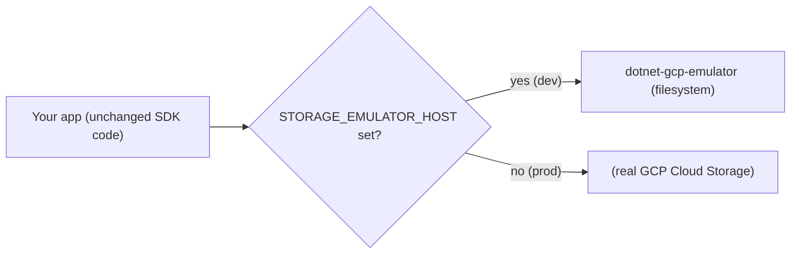

# dotnet-gcp-emulator

A local emulator for **Google Cloud Storage**, written in .NET 10. Google does not ship an
official Cloud Storage emulator (the community usually reaches for the Go-based
[`fake-gcs-server`](https://github.com/fsouza/fake-gcs-server)); this is a .NET-native
alternative that implements the GCS JSON API broadly, persists to the local filesystem, and is
designed to be a **drop-in** target for the official client libraries.

The guiding principle is **transparency**: your application talks to the emulator with exactly the
same code and SDK it uses against real GCS. The only thing that changes is a single environment
variable, `STORAGE_EMULATOR_HOST`. No "if emulator / else production" branching in business logic.



## Features

- **Buckets**: create, get, list, delete.
- **Objects**: upload (`media`, `multipart`, and the full **resumable** protocol), download
  (`alt=media`), get metadata, list (with `prefix` / `delimiter` roll-up), delete.
- **Path-style download** for V4 signed URLs: `GET /{bucket}/{object}`. Like `fake-gcs-server`,
  the signature query parameters are accepted but not verified.
- **Faithful payloads**: GCS-shaped JSON (`kind`, string `generation`/`size`/`metageneration`,
  `timeCreated`, `selfLink`, `mediaLink`, ...), correct `md5Hash` and `crc32c`, and GCS-style
  error envelopes (`error.errors[...]`).
- **Filesystem persistence**: survives restarts.
- **Dual routing**: the JSON API is served both under `/storage/v1/...` (what curl and the public
  endpoint use) and at the **root** `/...` (what the client libraries use when
  `STORAGE_EMULATOR_HOST` is set). Uploads are served under `/upload/storage/v1/...` and `/upload/...`.

## Quick start

### Run with the .NET SDK

```bash
dotnet run --project src/GcpStorageEmulator
# listens on http://0.0.0.0:8080, data under ./.gcs-data
curl http://localhost:8080/_health
```

### Run with Docker

```bash
docker compose up --build
```

`docker-compose.yml` persists data in a named volume (`gcs-data`) and exposes the port:

```bash
EMULATOR_PORT=9000 docker compose up      # host port 9000 -> container 8080
EMULATOR_LOG_REQUESTS=true docker compose up
```

To browse the stored files from the host, swap the named volume for a bind mount in
`docker-compose.yml`:

```yaml
    volumes:
      - ./.gcs-data:/data
```

## Configuration

Bind from the `Emulator` section of `appsettings.json` or from environment variables (note the
double underscore):

| Setting                   | Env var                      | Default           | Description                                              |
| ------------------------- | ---------------------------- | ----------------- | -------------------------------------------------------- |
| `Emulator:StorageRoot`    | `Emulator__StorageRoot`      | `./.gcs-data`     | Directory where buckets/objects are persisted.           |
| `Emulator:Port`           | `Emulator__Port`             | `8080`            | HTTP listen port (takes precedence over `ASPNETCORE_URLS`). |
| `Emulator:ExternalUrl`    | `Emulator__ExternalUrl`      | *(from request)*  | Base URL used in generated links / resumable session URIs. |
| `Emulator:DefaultProjectId` | `Emulator__DefaultProjectId` | `emulator-project` | Project reported for buckets that don't carry one.      |
| `Emulator:LogRequests`    | `Emulator__LogRequests`      | `false`           | Log every request (method, raw target, upload headers).  |

## Pointing the Google SDK at the emulator

This is the whole point: **production code is unchanged**. In .NET, build the `StorageClient`
with emulator detection and let the environment decide where it goes:

```csharp
// Same code in dev and prod. With STORAGE_EMULATOR_HOST set, traffic (including resumable
// uploads) goes to the emulator with no credentials; without it, it goes to real GCP.
var storage = new StorageClientBuilder
{
    EmulatorDetection = EmulatorDetection.EmulatorOrProduction
}.Build();
```

```bash
# dev only
export STORAGE_EMULATOR_HOST=localhost:8080
```

### Signed (download) URLs

`UrlSigner` builds the URL host into the V4 signature. To make a generated download URL point at
the emulator, pass the host/scheme/port through `UrlSigner.Options` from configuration. In
production those values are null, so the URL targets `https://storage.googleapis.com` exactly as
before:

```csharp
var options = UrlSigner.Options.FromDuration(TimeSpan.FromHours(1));
if (emulatorHost is not null) // e.g. derived from STORAGE_EMULATOR_HOST
{
    options = options.WithScheme("http").WithHost("localhost").WithPort(8080);
}
string url = signer.Sign(bucket, objectName, options);
```

The emulator serves that path-style URL and ignores the signature (see
[`fake-gcs-server`](https://github.com/fsouza/fake-gcs-server) for the same behaviour).

## curl examples

```bash
BASE=http://localhost:8080

# create a bucket
curl -X POST "$BASE/storage/v1/b?project=demo" \
  -H 'Content-Type: application/json' -d '{"name":"demo-bucket"}'

# upload an object (simple/media upload)
curl -X POST "$BASE/upload/storage/v1/b/demo-bucket/o?uploadType=media&name=hello.txt" \
  -H 'Content-Type: text/plain' --data 'Hello, GCS!'

# object metadata
curl "$BASE/storage/v1/b/demo-bucket/o/hello.txt"

# download the bytes
curl "$BASE/storage/v1/b/demo-bucket/o/hello.txt?alt=media"

# list (folders roll up with delimiter)
curl "$BASE/storage/v1/b/demo-bucket/o?delimiter=/"

# path-style download (what a signed URL hits)
curl "$BASE/demo-bucket/hello.txt?X-Goog-Signature=ignored"

# delete
curl -X DELETE "$BASE/storage/v1/b/demo-bucket/o/hello.txt"
```

## Endpoint reference

Every JSON route is also available at the root (drop the `/storage/v1` prefix); every upload route
is also available under `/upload`.

| Method       | Path                                              | Purpose                        |
| ------------ | ------------------------------------------------- | ------------------------------ |
| `GET`        | `/_health`                                        | Liveness + resolved storage root |
| `POST`       | `/storage/v1/b?project=`                          | Create bucket                  |
| `GET`        | `/storage/v1/b?project=`                          | List buckets                   |
| `GET`        | `/storage/v1/b/{bucket}`                          | Get bucket                     |
| `DELETE`     | `/storage/v1/b/{bucket}`                          | Delete bucket                  |
| `POST`       | `/upload/storage/v1/b/{bucket}/o?uploadType=media\|multipart\|resumable` | Upload object |
| `PUT`        | `/upload/storage/v1/b/{bucket}/o?upload_id=`      | Resumable chunk transfer       |
| `GET`        | `/storage/v1/b/{bucket}/o`                        | List objects (`prefix`, `delimiter`) |
| `GET`        | `/storage/v1/b/{bucket}/o/{object}`               | Object metadata                |
| `GET`        | `/storage/v1/b/{bucket}/o/{object}?alt=media`     | Download object bytes          |
| `DELETE`     | `/storage/v1/b/{bucket}/o/{object}`               | Delete object                  |
| `GET`/`HEAD` | `/{bucket}/{object}`                              | Path-style (signed URL) download |

## On-disk layout

```
{StorageRoot}/
  {bucket}/
    .bucket.json                 # bucket metadata
    .objects/
      {encodedName}.bin          # object bytes
      {encodedName}.json         # object metadata
  .uploads/
    {sessionId}.session.json     # in-flight resumable session
    {sessionId}.part             # partial bytes
```

Object names are flattened into a single, reversible, filesystem-safe segment (slashes become
`%2F`). This is deliberate: in GCS an object named `a` and an object named `a/b` can coexist, which
a naive nested-directory layout cannot represent.

## Limitations

- **No authentication and no signature verification.** The emulator is for local development and
  testing only — do not expose it on an untrusted network.
- Object versioning, ACLs/IAM, lifecycle rules, compose, rewrite/copy and notifications are not
  implemented.
- Object listing returns a single page (no `maxResults` / `nextPageToken` paging); clients that
  auto-paginate still receive the full set.
- Very long object names may hit the host filesystem's path-length limits.

## Development

```bash
dotnet build DotnetGcpEmulator.slnx

# tests run on Microsoft.Testing.Platform (xUnit v3) as a plain executable
dotnet build tests/GcpStorageEmulator.Tests
./tests/GcpStorageEmulator.Tests/bin/Debug/net10.0/GcpStorageEmulator.Tests   # or .exe on Windows
```

The suite includes unit tests for the store and HTTP integration tests that boot the emulator on a
real Kestrel socket, plus end-to-end tests that drive it with the real
`Google.Cloud.Storage.V1` SDK (covering the resumable upload protocol).
